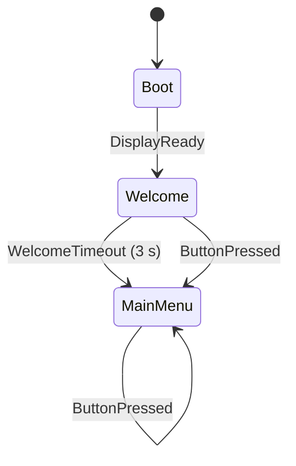

# Zustandsmaschinen

Constitution, Prinzip VIII: Zustände als `enum class`, eine zentrale Übergangstabelle, nicht
definierte Übergänge werden abgewiesen. Code und dieses Dokument müssen übereinstimmen.

## Bildschirmablauf (`UiStateMachine`)

Code: `firmware/lib/ui/src/ui_state_machine.cpp` (Tabelle `kTransitions`).
Tests: `firmware/test/test_ui_state_machine/`.

| Von | Ereignis | Nach | Aktion |
|---|---|---|---|
| `Boot` | `DisplayReady` | `Welcome` | Begrüßung zeichnen, Timer 3000 ms starten |
| `Welcome` | `WelcomeTimeout` | `MainMenu` | Inhaltsbereich löschen, Menü zeichnen |
| `Welcome` | `ButtonPressed` | `MainMenu` | Inhaltsbereich löschen, Menü zeichnen |
| `MainMenu` | `RotateCw` | `MainMenu` | Cursor +1 (ohne Umlauf), alten und neuen Eintrag neu zeichnen |
| `MainMenu` | `RotateCcw` | `MainMenu` | Cursor −1 (ohne Umlauf), alten und neuen Eintrag neu zeichnen |
| `MainMenu` | `ButtonPressed` | `MainMenu` | Eintrag auswählen; in Feature 001 ohne Aktion, nur Log |

Alle anderen Kombinationen werden abgewiesen, ändern den Zustand nicht und werden als
`lvl=DEBUG mod=ui msg="transition rejected"` geloggt.

## Betriebszustände des Ofens

Folgt mit dem Feature „Sichere Temperaturregelung" (Idle, Heizen, Halten, Abkühlen, Fehler
usw. inklusive verriegelndem Fehlerzustand). Derzeit gibt es nur „Idle, Heizung AUS": Die
Firmware steuert keinen Heizungsausgang an.
