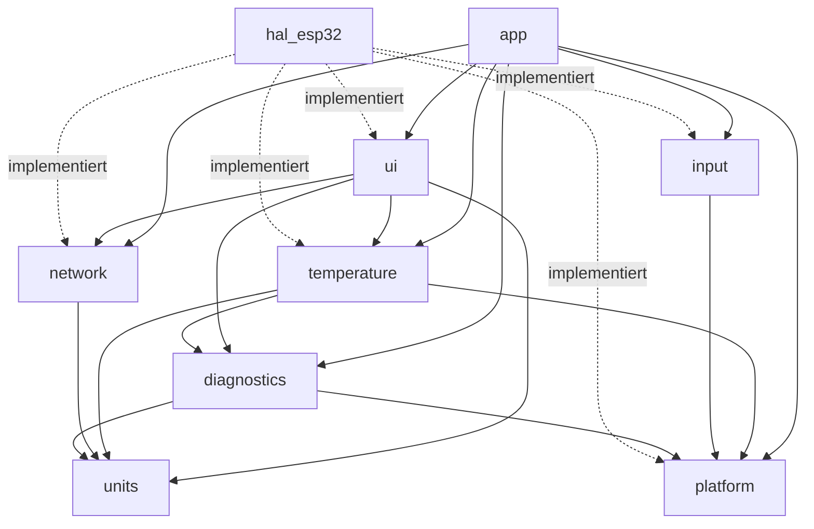

# Contract: Modul-Schnittstellen

**Feature**: [../spec.md](../spec.md) | **Plan**: [../plan.md](../plan.md)

Verträge der öffentlichen Interfaces (Prinzip I/II). Signaturen sind verbindlich in Name,
Parametern, Einheiten und Fehlerverhalten; Doxygen-Kommentare im Code wiederholen diese
Angaben. Alle Methoden sind nicht-blockierend und allokieren keinen Speicher.

## Abhängigkeiten der Module



Keine Zyklen. `hal_esp32` wird nur vom Composition Root (`src/main.cpp`) eingebunden.

## platform

```cpp
/// Monotone Zeitquelle.
class IClock {
public:
    virtual ~IClock() = default;
    /// @return Zeit seit Start in ms; läuft nach ~49 Tagen über (Differenzen sind gültig).
    virtual Milliseconds now() const = 0;
};

/// Hardware-Watchdog.
class IWatchdog {
public:
    virtual ~IWatchdog() = default;
    /// Aktiviert den Watchdog mit dem Timeout aus app_config.h. Einmalig aufrufen.
    virtual void start() = 0;
    /// Muss mindestens einmal pro Timeout aufgerufen werden, sonst Neustart.
    virtual void feed() = 0;
};

/// Nicht-blockierende serielle Ausgabe.
class ISerialOut {
public:
    virtual ~ISerialOut() = default;
    /// Schreibt len Bytes, wenn sie vollständig in den Sendepuffer passen.
    /// @return true wenn geschrieben, false wenn verworfen (Puffer voll). Blockiert nie.
    virtual bool tryWrite(const char* data, size_t len) = 0;
};

/// Informationen zum letzten Neustart.
class ISystemInfo {
public:
    virtual ~ISystemInfo() = default;
    /// @return Kurzname des Reset-Grunds, z. B. "power_on", "brownout", "task_wdt".
    virtual const char* resetReason() const = 0;
};
```

## diagnostics

```cpp
enum class LogLevel : uint8_t { Error = 1, Warn = 2, Info = 3, Debug = 4 };

/// Strukturiertes Logging; Format siehe log-format.md.
class ILogger {
public:
    virtual ~ILogger() = default;
    /// @param module kurzer Modulname ohne Leerzeichen, z. B. "temp"
    /// @param message Freitext, wird in Anführungszeichen gesetzt
    /// @param fields optionale zusätzliche key=value-Paare (ohne führendes Leerzeichen) oder nullptr
    /// Verwirft die Zeile, wenn level über dem Compile-Zeit-Level liegt oder der Puffer voll ist.
    virtual void log(LogLevel level, const char* module, const char* message,
                     const char* fields = nullptr) = 0;
};
```

Implementierungen: `Logger` (formatiert über `LogFormatter` in einen festen Puffer von
256 Byte, gibt über `ISerialOut` aus), `NullLogger` (bei `OVEN_LOG_LEVEL=0`).

## temperature

```cpp
/// Rohzugriff auf den Thermoelement-Wandler (HAL).
class IThermocoupleBus {
public:
    virtual ~IThermocoupleBus() = default;
    /// Liest ein 32-Bit-Rohwort des MAX31855 (MSB zuerst). Dauer < 50 µs.
    virtual uint32_t readRaw() = 0;
};

/// Bewertete Ofentemperatur für Anzeige und spätere Regelung.
class ITemperatureSensor {
public:
    virtual ~ITemperatureSensor() = default;
    /// Führt eine Messung aus und aktualisiert den Zustand. Periode: 250 ms.
    virtual void sample(Milliseconds now) = 0;
    /// @return aktueller Zustand (siehe data-model.md, OvenTemperature).
    virtual OvenTemperature current() const = 0;
};
```

Implementierung: `OvenTemperatureMonitor(IThermocoupleBus&, ILogger&)` nutzt
`Max31855Decoder` (statische, reine Funktion `decode(uint32_t) -> TemperatureReading`).

## network

```cpp
/// WLAN-Zustand (FR-003).
class INetworkStatus {
public:
    virtual ~INetworkStatus() = default;
    /// Startet den Verbindungsaufbau im Hintergrund. Kehrt sofort zurück.
    virtual void begin() = 0;
    /// Verarbeitet anstehende WLAN-Ereignisse und loggt Zustandswechsel (Hauptschleife, 1 s).
    virtual void poll() = 0;
    virtual WifiState state() const = 0;
};

/// Ortszeit (FR-004/FR-005).
class IWallClock {
public:
    virtual ~IWallClock() = default;
    /// Konfiguriert Zeitzone und Zeitserver. Kehrt sofort zurück.
    virtual void begin() = 0;
    /// Erkennt und loggt die erste Synchronisation (Hauptschleife, 1 s).
    virtual void poll() = 0;
    /// @return aktuelle Ortszeit; valid == false, solange keine Synchronisation erfolgt ist.
    virtual WallClockTime now() const = 0;
};
```

## input

```cpp
enum class InputEvent : uint8_t { None, RotateCw, RotateCcw, Pressed };

/// Bedienereignisse des Drehencoders.
class IRotaryInput {
public:
    virtual ~IRotaryInput() = default;
    /// Tastet den Taster ab und sammelt Drehschritte. Periode: 5 ms.
    virtual void poll(Milliseconds now) = 0;
    /// @return nächstes Ereignis oder None. Mehrere Ereignisse werden in Reihenfolge geliefert.
    virtual InputEvent nextEvent() = 0;
};

/// Pin-Zugriff des Encoders (HAL).
class IEncoderPins {
public:
    virtual ~IEncoderPins() = default;
    /// @return seit dem letzten Aufruf aufgelaufene Rastungen (+ = Uhrzeigersinn), atomar gelesen.
    virtual int32_t takeDetents() = 0;
    /// @return true, wenn der Taster gerade gedrückt ist (Pegel LOW).
    virtual bool buttonLevelPressed() const = 0;
};
```

Implementierung: `RotaryInput(IEncoderPins&)` mit `ButtonDebouncer` (20 ms). Die Funktion
`QuadratureDecoder::step(prevAB, currAB) -> int8_t` ist reine Logik und wird von der ISR in
`hal_esp32` genutzt.

## ui

```cpp
enum class Color : uint8_t { Background, Foreground, Accent, Warning, Error, Muted };
enum class FontSize : uint8_t { Small, Medium, Large };
enum class Align : uint8_t { Left, Center, Right };

/// Minimale Zeichenschnittstelle (HAL: LovyanGFX).
class IGraphics {
public:
    virtual ~IGraphics() = default;
    virtual uint16_t width() const = 0;   ///< in Pixel
    virtual uint16_t height() const = 0;  ///< in Pixel
    virtual void fillRect(int16_t x, int16_t y, uint16_t w, uint16_t h, Color color) = 0;
    /// Füllt die Box mit bg und zeichnet Text (UTF-8, deutsche Umlaute und °) vertikal
    /// zentriert und horizontal ausgerichtet hinein; Überstand wird abgeschnitten.
    virtual void drawText(int16_t x, int16_t y, uint16_t w, uint16_t h, const char* text,
                          FontSize size, Color fg, Color bg, Align align) = 0;
};
```

Logik-Klassen ohne Hardwarebezug: `UiStateMachine`, `MainMenu`, `StatusFormatter`
(`SystemStatus` → Texte), `WelcomeScreen`, `MenuScreen`, `StatusBar` (zeichnen über
`IGraphics`). Layout siehe [ui-screens.md](ui-screens.md).

## app

- `Scheduler`: feste Tabelle periodischer Aufgaben (max. 8), Perioden in `Milliseconds`,
  überlaufsicher.
- `AppController(IWatchdog&, ITemperatureSensor&, INetworkStatus&, IWallClock&,
  IRotaryInput&, IGraphics&, ILogger&, MainMenu&, const FirmwareIdentity&)` mit
  `setup(Milliseconds now)` und `tick(Milliseconds now)`; die Zeit liefert der Composition
  Root aus `IClock`.
