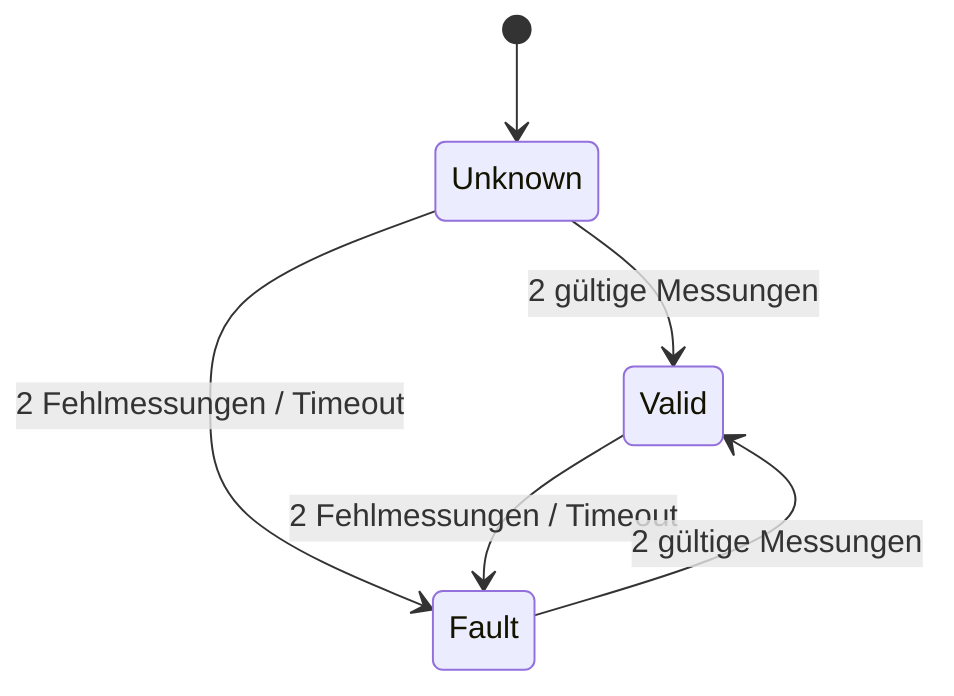

# Data Model: Startbildschirm mit Statusanzeige und Hauptmenü

**Feature**: [spec.md](spec.md) | **Plan**: [plan.md](plan.md)

Alle Typen sind Werttypen ohne dynamischen Speicher. Physikalische Größen tragen ihre Einheit
im Typ. Bezeichner im Code sind englisch; die Begriffe der Spezifikation stehen in Klammern.

## Grundtypen (`lib/units`)

| Typ | Inhalt | Regeln |
|---|---|---|
| `Celsius` | `float value` | Anzeige gerundet auf ganze Grad (kaufmännisch) |
| `Milliseconds` | `uint32_t value` | Zeit seit Start; Vergleiche überlaufsicher (Differenzbildung) |

## ErrorCode (`lib/diagnostics`)

`enum class ErrorCode : uint16_t`, zentral definiert, Werte stabil (Prinzip IX).

| Code | Name | Bedeutung | Auslöser |
|---|---|---|---|
| 0 | `None` | kein Fehler | – |
| 101 | `ThermocoupleOpen` | Fühler nicht angeschlossen oder Leitung unterbrochen | MAX31855 Fault-Bit OC |
| 102 | `ThermocoupleShortGnd` | Fühler-Kurzschluss gegen GND | Fault-Bit SCG |
| 103 | `ThermocoupleShortVcc` | Fühler-Kurzschluss gegen VCC | Fault-Bit SCV |
| 104 | `TemperatureImplausible` | Messwert außerhalb −20 … 350 °C | Bereichsprüfung |
| 105 | `SensorNoResponse` | Sensor antwortet nicht oder Messwert veraltet | Rohwort `0x00000000`/`0xFFFFFFFF` oder > 1000 ms kein gültiger Wert |

Anzeigeformat: `E` + dreistellige Zahl, z. B. `E101`. Die Codes werden in
`docs/error-codes.md` mit Ursache und Abhilfe dokumentiert.

## TemperatureReading (Ofentemperatur)

Ergebnis einer Einzelmessung (`Max31855Decoder::decode(uint32_t raw)`).

| Feld | Typ | Bedeutung |
|---|---|---|
| `status` | `ErrorCode` | `None` oder 101/102/103/105 |
| `hotJunction` | `Celsius` | Ofentemperatur (Auflösung 0,25 °C), nur gültig bei `status == None` |
| `coldJunction` | `Celsius` | Vergleichsstelle (Auflösung 0,0625 °C), nur für Log |

**Validierung im Decoder**: Rohwort `0x00000000` oder `0xFFFFFFFF` → 105. Bit 16 (Fault)
gesetzt → Code aus Bits 0–2 (OC → 101, SCG → 102, SCV → 103). Vorzeichenbehaftete
14-Bit-Temperatur (Bits 31–18) × 0,25 °C; 12-Bit-Vergleichsstelle (Bits 15–4) × 0,0625 °C.

## OvenTemperature (Statuswert der Ofentemperatur)

Ergebnis von `OvenTemperatureMonitor` nach Plausibilisierung und Entprellung; das ist der Wert,
den die UI anzeigt.

| Feld | Typ | Bedeutung |
|---|---|---|
| `valid` | `bool` | Temperatur darf angezeigt werden |
| `temperature` | `Celsius` | zuletzt gültige Temperatur |
| `error` | `ErrorCode` | aktiver Fehler oder `None` |

**Regeln** (Konstanten in `app_config.h`):

- Messwert außerhalb `kPlausibleMin = −20 °C` … `kPlausibleMax = 350 °C` → 104.
- `kFaultDebounceSamples = 2` fehlerhafte Messungen in Folge → `valid = false`, `error` = Code
  der letzten Fehlmessung.
- `kRecoverSamples = 2` gültige Messungen in Folge → `valid = true`, `error = None`.
- Seit `kStaleTimeout = 1000 ms` kein gültiger Wert → `valid = false`, `error = 105`.
- Vor der ersten gültigen Messung: `valid = false`, `error = None` → Anzeige `--- °C`.
- Jeder Wechsel von `error` wird geloggt (`WARN` beim Auftreten, `INFO` beim Verschwinden).

**Zustandsübergänge**:

## NetworkState (WLAN-Zustand)

`enum class WifiState : uint8_t { NotConfigured, Disconnected, Connected }`

| Wert | Anzeige | Bedingung |
|---|---|---|
| `NotConfigured` | „WLAN nicht eingerichtet" | `wifi_secrets.h` fehlt oder Netzwerkname leer |
| `Disconnected` | „WLAN nicht verbunden" | Zugangsdaten vorhanden, keine Verbindung (auch während des Verbindungsaufbaus) |
| `Connected` | „WLAN verbunden" | IP-Adresse erhalten |

Übergänge werden geloggt (inkl. RSSI bei `Connected`, Grund bei `Disconnected`).

## WallClockTime (Uhrzeit und Datum)

| Feld | Typ | Bedeutung |
|---|---|---|
| `valid` | `bool` | true nach erstem SNTP-Sync **und** Jahr ≥ 2026 |
| `year`, `month`, `day` | `uint16_t`, `uint8_t`, `uint8_t` | Ortsdatum (MEZ/MESZ) |
| `hour`, `minute` | `uint8_t` | Ortszeit |

`valid` bleibt nach einem WLAN-Abbruch wahr (Systemuhr läuft weiter). Anzeige: `HH:MM` und
`TT.MM.JJJJ`; bei `valid == false` die Platzhalter `--:--` bzw. `--.--.----`, wenn
WLAN verbunden ist, sonst wird nichts angezeigt (siehe [contracts/ui-screens.md](contracts/ui-screens.md)).

## SystemStatus (Systemstatus)

Momentaufnahme für die Statuszeile; wird vom `AppController` zusammengesetzt.

| Feld | Typ |
|---|---|
| `wifi` | `WifiState` |
| `clock` | `WallClockTime` |
| `oven` | `OvenTemperature` |

Die UI zeichnet einen Bereich nur neu, wenn sich der formatierte Text gegenüber dem zuletzt
gezeichneten geändert hat.

## FirmwareIdentity

| Feld | Typ | Quelle |
|---|---|---|
| `version` | `const char*` (z. B. `"0.1.0"`) | `app_version.h` |
| `pcbRevision` | `const char*` (z. B. `"DEV"`) | `board_rev_dev.h` |

## MenuEntry (Menüeintrag) und MainMenu

| Feld | Typ | Bedeutung |
|---|---|---|
| `id` | `enum class MenuEntryId : uint8_t { Heat, Profile, Setup }` | stabile Kennung |
| `label` | `const char*` | „Heizen", „Profil", „Setup" |

`MainMenu` hält ein fest dimensioniertes Array (`kMaxMenuEntries = 8`) und den Cursor-Index.

- Drehen im Uhrzeigersinn → Cursor +1, gegen den Uhrzeigersinn → −1; **kein Umlauf** am Anfang
  und Ende (Cursor bleibt stehen).
- Drücken → liefert die `MenuEntryId` des markierten Eintrags zurück. In diesem Feature ist
  jeder Eintrag mit „keine Aktion" verknüpft; der Cursor und die Anzeige bleiben unverändert,
  die Auswahl wird geloggt.
- Neue Einträge werden im Composition Root ergänzt; `MainMenu` selbst ändert sich dafür nicht
  (FR-012).

## UiStateMachine (Anzeigezustand)

`enum class UiScreen : uint8_t { Boot, Welcome, MainMenu }`

`enum class UiEvent : uint8_t { DisplayReady, WelcomeTimeout, ButtonPressed, RotateCw, RotateCcw }`

| Von | Ereignis | Nach | Aktion |
|---|---|---|---|
| `Boot` | `DisplayReady` | `Welcome` | Begrüßung zeichnen, Timer 3000 ms starten |
| `Welcome` | `WelcomeTimeout` | `MainMenu` | Menü zeichnen |
| `Welcome` | `ButtonPressed` | `MainMenu` | Menü zeichnen |
| `MainMenu` | `RotateCw` / `RotateCcw` | `MainMenu` | Cursor bewegen, Menü neu zeichnen |
| `MainMenu` | `ButtonPressed` | `MainMenu` | Eintrag auswählen (keine Aktion), loggen |

Alle anderen Kombinationen werden abgewiesen, ändern den Zustand nicht und werden auf
`DEBUG` geloggt. Die Tabelle ist die einzige Quelle der Übergänge und wird 1:1 in
`docs/state-machine.md` übernommen. Ein Fehlerzustand für den Ofenbetrieb kommt mit dem
Heiz-Feature hinzu.

## LogRecord

Siehe [contracts/log-format.md](contracts/log-format.md).
