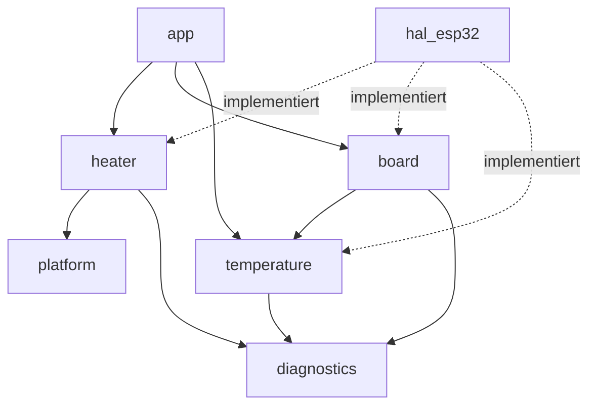

# Contracts: Firmware-Schnittstellen für REV A

Neue und geänderte Schnittstellen. Konventionen wie in Feature 001: Präfix `I`, Doxygen mit
Einheiten und Fehlerverhalten, keine Exceptions, Einheiten im Typ (`Celsius`, `Milliseconds`).
Bestehende Schnittstellen ohne Änderung sind in
[specs/001-startup-status-menu/contracts/interfaces.md](../../001-startup-status-menu/contracts/interfaces.md)
beschrieben.

## Abhängigkeiten (neu/geändert)



Zyklenfrei; `hal_esp32` ist weiterhin das einzige Modul mit Arduino-/ESP-IDF-Abhängigkeiten.

## temperature (geändert)

```cpp
/// Delivers one decoded thermocouple conversion (replaces direct use of IThermocoupleBus
/// by OvenTemperatureMonitor).
class IThermocoupleReader {
public:
    virtual ~IThermocoupleReader() = default;
    /// Reads the latest conversion. Non-blocking, < 100 us.
    /// @return status None with hot/cold junction in degC, or the mapped error code
    ///         (101-108); never throws
    virtual TemperatureReading read() = 0;
};

/// Register access to a MAX31856 (HAL). One instance per chip select.
class IMax31856Bus {
public:
    virtual ~IMax31856Bus() = default;
    /// Writes one register (address 0x00-0x0B). @return false if the chip does not answer
    virtual bool writeRegister(uint8_t address, uint8_t value) = 0;
    /// Reads `length` consecutive registers starting at `address` into `out`.
    /// @return false if the chip does not answer (all bytes 0x00 or 0xFF)
    virtual bool readRegisters(uint8_t address, uint8_t* out, uint8_t length) = 0;
};
```

- `Max31855Reader(IThermocoupleBus&)` – REV DEV, nutzt den bestehenden `Max31855Decoder`.
- `Max31856Reader(IMax31856Bus&, ILogger&)` – REV A: `configure()` schreibt die
  Soll-Konfiguration (research R4) und gibt `false` bei Fehler zurück; `read()` liest
  Temperaturen und Fehlerregister; jede 10. Abfrage vergleicht die Konfigurationsregister mit dem
  Soll (Abweichung → E105). `clearFault()` quittiert den Fehlerausgang.
- `Max31856Decoder` – reine Funktionen: Rohbytes → `TemperatureReading`, Fehlerbits → Code
  (Tabelle in [data-model.md](../data-model.md#messkanal)). Host-getestet.
- `OvenTemperatureMonitor(IThermocoupleReader&, ILogger&, const char* channelName)` – Logik
  unverändert, Kanalname für Log und Anzeige.

## heater (neu)

```cpp
enum class HeaterChannel : uint8_t { Top, Bottom };

/// Low-side heater commands (HAL). Outputs are off after reset (hardware pull-down).
class IHeaterOutputs {
public:
    virtual ~IHeaterOutputs() = default;
    virtual void set(HeaterChannel channel, bool on) = 0;
    virtual void allOff() = 0;
};

/// Hardware enable flip-flop (HAL).
class IEnableLatch {
public:
    virtual ~IEnableLatch() = default;
    /// Rising edge on ARM. Has no effect while a clear source is active.
    virtual void arm() = 0;
    /// Pulls /MR of the external supervisor; clears the latch within 1 ms.
    virtual void disarm() = 0;
    virtual bool isArmed() const = 0;          ///< Q read back
    virtual bool isClearActive() const = 0;    ///< CLR_SENSE read back
};

/// Normally-open contact of the stop button (HAL).
class IStopButton {
public:
    virtual ~IStopButton() = default;
    virtual bool isPressed() const = 0;
};

/// External watchdog input (HAL).
class IExternalWatchdog {
public:
    virtual ~IExternalWatchdog() = default;
    virtual void toggle() = 0;
};

/// Decides when the external watchdog may be fed (host-testable).
class SafetyHeartbeat {
public:
    explicit SafetyHeartbeat(IExternalWatchdog& watchdog);
    void reportTemperatureCheck(Milliseconds now);
    void reportBoardCheck(Milliseconds now);
    /// Toggles WDI only if both reports are younger than config::kHeartbeatMaxAgeMs and
    /// config::kHeartbeatPeriodMs has passed. Call from the main loop only.
    void tick(Milliseconds now);
};
```

## board (neu)

```cpp
enum class PcbRevisionId : uint8_t { Dev, A, Unknown };

/// Revision strap voltage (HAL). REV DEV returns std::nullopt-like "absent".
class IRevisionStrap {
public:
    virtual ~IRevisionStrap() = default;
    /// @return true and the averaged voltage in mV, or false if the board has no strap
    virtual bool readMillivolts(uint16_t& outMillivolts) = 0;
};

/// Maps the strap voltage to a revision and checks it against the compiled board.
class RevisionDetector {
public:
    explicit RevisionDetector(IRevisionStrap& strap);
    PcbRevisionId detect();
    /// @return ErrorCode::None or UnsupportedPcbRevision (204)
    ErrorCode check(PcbRevisionId compiledFor);
};

/// Evaluates the PCB temperature from the cold junctions of both channels.
class PcbTemperatureMonitor {
public:
    PcbTemperatureMonitor(ITemperatureSensor& top, ITemperatureSensor& bottom, ILogger& logger);
    void sample(Milliseconds now);
    /// @return None, PcbOverTemperature (201) or PcbTemperatureUnknown (202)
    ErrorCode status() const;
    Celsius celsius() const;
};
```

`OvenTemperature` (Feature 001) bekommt das Feld `coldJunction`, damit
`PcbTemperatureMonitor` nur `ITemperatureSensor` braucht.

## Log-Ereignisse (neu)

Format wie [Feature 001 log-format](../../001-startup-status-menu/contracts/log-format.md):

| Ereignis | Beispiel |
|---|---|
| Revision | `lvl=INFO mod=board msg="revision" detected=A compiled=A strap_mv=1650` |
| Freigabe gesetzt | `lvl=INFO mod=heater msg="armed"` |
| Freigabe gelöscht (Firmware) | `lvl=INFO mod=heater msg="disarmed" reason=fault code=E201` |
| Hardware-Abschaltung | `lvl=WARN mod=heater msg="hardware trip" code=E205 cause=stop` |
| Platinentemperatur | `lvl=WARN mod=board msg="pcb over temperature" code=E201 celsius=61.2` |
| Messbaustein-Konfiguration | `lvl=ERROR mod=temp msg="config mismatch" ch=top code=E105` |
