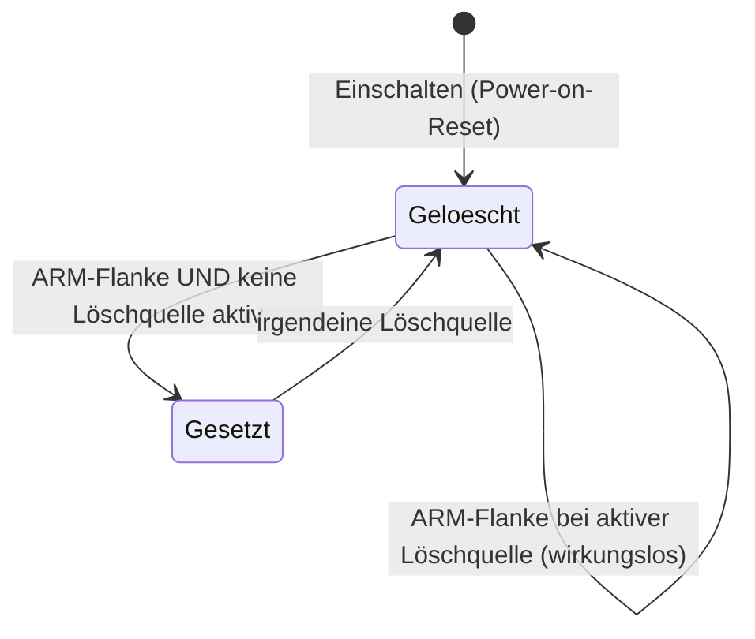

# Data Model: Controller-Platine (PCB REV A)

Entitäten aus [spec.md](spec.md) mit Feldern, Regeln und Zustandswechseln. Typen sind
sprachneutral beschrieben; die C++-Signaturen stehen in
[contracts/interfaces.md](contracts/interfaces.md).

## PCB-Revision

| Feld | Bedeutung |
|---|---|
| `id` | `Dev`, `A`, `Unknown` |
| `label` | Anzeigetext „DEV", „REV A" |
| `strapMillivolts` | gemessene Spannung am Revisionsteiler (nur REV A und später) |

Regeln:
- REV A: Fenster 1450–1850 mV. Außerhalb jedes Fensters → `Unknown`.
- Messung: 8 Einzelwerte beim Start, Mittelwert.
- Compile-Zeit-Board ≠ erkannte Revision oder `Unknown` → Fehler **E204**, Heizausgänge aus,
  DISARM dauerhaft, Anzeige des Fehlers. REV DEV hat keinen Teiler und gilt immer als `Dev`.

## Heizungsfreigabe (Hardware-Speicher)

Die Freigabe ist ein Flipflop auf der Platine, kein Firmware-Zustand. Die Firmware kann sie
setzen (ARM), löschen (DISARM) und lesen.

| Zustand | SSR-Versorgung | Sicherheitsrelais | Heizkreis führt Strom |
|---|---|---|---|
| Gelöscht | aus | offen | nie |
| Gesetzt | an | geschlossen | nur bei Heizbefehl des Kanals |

Firmware-Sicht (`EnableStatus`):

| Feld | Quelle | Bedeutung |
|---|---|---|
| `armed` | Q-Rücklesen (GPIO 47) | Freigabe gesetzt |
| `clearActive` | `CLR_SENSE` (GPIO 36) | mindestens eine Löschquelle aktiv |
| `stopPressed` | Stopp-Schließer (GPIO 42) | Stopp-Taste gedrückt |

Plausibilitätsregeln (E203 `EnableLatchMismatch`):
- `armed` ohne vorheriges ARM seit dem letzten DISARM.
- `armed` bleibt nach DISARM länger als 10 ms gesetzt.
- `armed` und `clearActive` gleichzeitig länger als 10 ms.

## Löschquelle

| Quelle | Hardware | Firmware-Unterscheidung |
|---|---|---|
| Stopp-Taste / Stopp-Leitung unterbrochen | Öffner | `stopPressed` (bei Leitungsbruch: `clearActive` ohne `stopPressed`) |
| Kammer-Übertemperatur / Fühlerfehler | FAULT MAX31856 oben/unten | Fehlerregister des jeweiligen Kanals |
| Platinen-Übertemperatur | TC6501 | `clearActive` ohne andere Ursache; CJ-Werte hoch |
| Watchdog / Unterspannung 3,3 V | TPS3828 /RESET | Reset-Grund bzw. ausgebliebener Herzschlag |
| Firmware | DISARM über /MR des TPS3828 | eigener Aufruf |

Erkennt die Firmware einen Übergang `armed` → nicht `armed`, ohne selbst DISARM ausgelöst zu
haben, meldet sie **E205** `HardwareTrip` mit der ermittelten Ursache im Log.

## Messkanal

| Feld | Bedeutung |
|---|---|
| `channel` | `Top`, `Bottom` |
| `reading.status` | `None` oder Fehlercode (101–108) |
| `reading.hotJunction` | Kammertemperatur, °C |
| `reading.coldJunction` | Vergleichsstelle = Platinentemperatur an dieser Stelle, °C |

Zuordnung der MAX31856-Fehlerbits:

| Fehlerbit | Code |
|---|---|
| OPEN (Fühlerbruch) | E101 `ThermocoupleOpen` |
| OVUV (Eingang über/unter Versorgung) | E106 `ThermocoupleOverUnderVoltage` |
| TCHIGH (Kammer-Obergrenze) | E107 `ChamberOverTemperature` |
| CJRANGE, CJHIGH, CJLOW | E108 `ColdJunctionOutOfRange` |
| TCRANGE, TCLOW | E104 `TemperatureImplausible` |
| Keine Antwort, Register weichen ab, veralteter Wert | E105 `SensorNoResponse` |

Plausibilität, Entprellung und Veraltungserkennung wie in Feature 001 (`OvenTemperatureMonitor`),
je Kanal eigene Instanz.

## Platinentemperatur

| Feld | Bedeutung |
|---|---|
| `valid` | mindestens ein gültiger CJ-Wert |
| `celsius` | Maximum der gültigen CJ-Werte |
| `status` | `None`, E201, E202 |

Regeln: `celsius ≥ 60 °C` → E201; kein gültiger Wert → E202. Beide lösen DISARM aus. Die Meldung
wird erst gelöscht, wenn der Wert 5 s lang unter 55 °C liegt (Hysterese).

## Platinenlüfter

| Feld | Bedeutung |
|---|---|
| `dutyPercent` | Sollwert 20–100 % aus der Kennlinie |
| `rpm` | gemessene Drehzahl (Pulse je Sekunde × 60 ÷ 2) |
| `status` | `None`, E206 |

Kennlinie (FR-038): `celsius ≤ 35` → 20 %; `35 < celsius < 50` → linear 20…100 %;
`celsius ≥ 50` → 100 %; Platinentemperatur ungültig (E202) → 100 %. Überwachung (FR-037):
`rpm < 500` für 3 s → E206, DISARM, verriegelnd bis zur Quittierung (Anlaufzeit: die ersten 3 s
nach dem Start werden nicht bewertet). Grenzwerte als `constexpr` in `app_config.h`.

## Heizkreis

| Feld | Bedeutung |
|---|---|
| `channel` | `Top`, `Bottom` |
| `commanded` | Heizbefehl der Firmware (Low-Side-Ausgang) |

Regel: Strom nur bei `commanded` UND Freigabe gesetzt (Hardware-UND). In diesem Feature setzt
die Firmware `commanded` nur in HIL-Tests.

## Neue Fehlercodes

| Code | Name | Bedeutung |
|---|---|---|
| E106 | `ThermocoupleOverUnderVoltage` | Spannung am Fühlereingang außerhalb der Versorgung (Kurzschluss) |
| E107 | `ChamberOverTemperature` | Kammer-Obergrenze im Messbaustein überschritten |
| E108 | `ColdJunctionOutOfRange` | Vergleichsstelle außerhalb des Messbereichs |
| E201 | `PcbOverTemperature` | Platinentemperatur ≥ 60 °C |
| E202 | `PcbTemperatureUnknown` | kein gültiger Platinentemperaturwert |
| E203 | `EnableLatchMismatch` | Freigabe verhält sich anders als angesteuert |
| E204 | `UnsupportedPcbRevision` | Revision unbekannt oder passt nicht zur Firmware |
| E205 | `HardwareTrip` | Freigabe durch eine Hardware-Löschquelle gelöscht |
| E206 | `FanFailure` | Platinenlüfter steht oder dreht zu langsam (blockiert, abgezogen, defekt) |

Anzeige mit Kanal, wo zutreffend: „E101 oben", „E107 unten".

## Herzschlag für den externen Watchdog

`SafetyHeartbeat` bekommt je Zyklus die Meldung „Temperaturüberwachung gelaufen" und
„Platinenüberwachung gelaufen" mit Zeitstempel. WDI wird nur umgeschaltet, wenn beide Meldungen
jünger als 500 ms sind und seit dem letzten Umschalten mindestens 250 ms vergangen sind.
